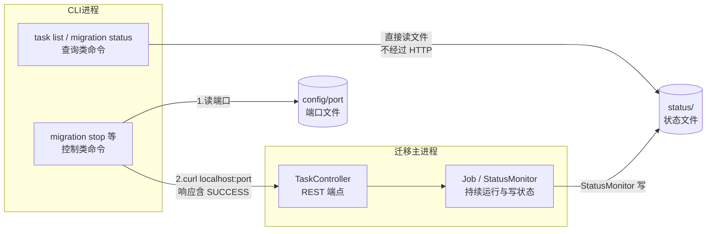
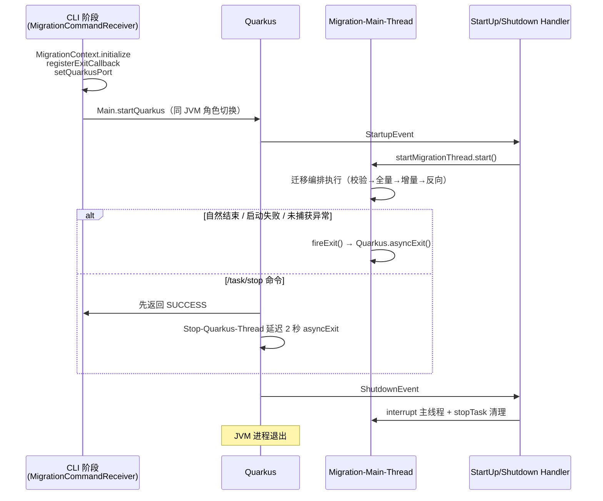
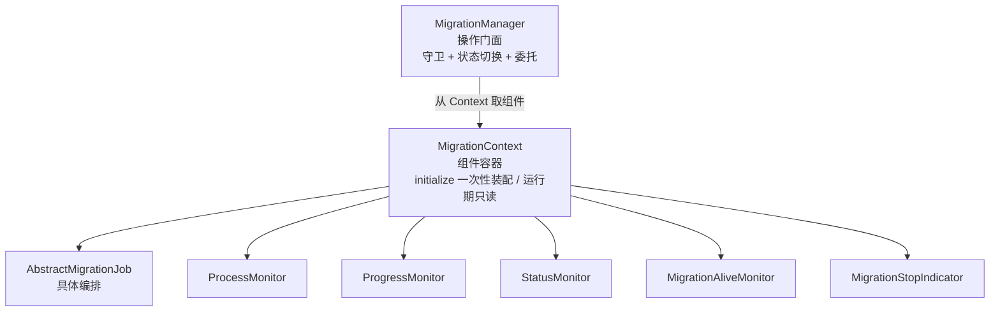
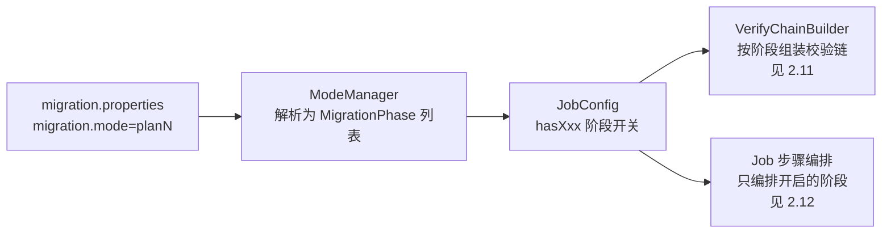

# 2 核心业务设计

> - 本章聚焦 portal 的核心设计点：每个设计点讲清"是什么、怎么实现、为什么这样设计"。
> - 涉及的代码路径均相对 `multidb-portal/` 目录。

## 2.1 Portal单例

**要解决的问题**：portal 的 9 个目录（bin/config/pkg/template/workspace/tools/data/logs/tmp）与平台信息被所有模块使用。如果各处自行拼接路径，会遇到两个麻烦：一是 2.4 所述两种进程角色的 CWD 不同，相对路径会随"谁在执行"而解析出不同结果；二是目录是否存在需要在每个使用点反复检查。

**核心逻辑**：[Portal.java](../portal-common/src/main/java/org/opengauss/config/Portal.java) 位于 portal-common，私有构造 + volatile + 双检锁懒加载单例。首次 `getInstance()` 时完成三步装配：

```java
private void loadConfig() {
    instance.portalHomeDirPath = loadPortalHomeDir();      // ① 基于 jar 实际位置解析安装根目录

    String configPath = instance.portalHomeDirPath + "/config/application.properties";
    // ...读取 properties
    instance.systemName = properties.getProperty("system.name");    // ② 从配置文件加载安装包系统名称/架构
    instance.systemArch = properties.getProperty("system.arch");
}

private static String loadPortalHomeDir() {
    String classPath = Portal.class.getProtectionDomain().getCodeSource().getLocation().getPath();
    return new File(classPath).getParent();                // jar 所在目录即安装根目录
}
```

随后 `initPortalDir()` 一次性创建 9 个目录（目录名常量定义于 [PortalConstants](../portal-common/src/main/java/org/opengauss/constants/PortalConstants.java)），目录已存在时不报错，因此装配是幂等的。

三个关键选择的依据：

- **安装根从 jar 位置推导而非 CWD**——这是 2.1 与 2.4 的关键配合：无论进程从哪个目录启动、CWD 是什么，`loadPortalHomeDir()` 都返回同一绝对路径；
- **系统名称/架构从配置文件加载而非运行时探测**——目标平台在构建期已知（build.sh 写入 application.properties），运行期探测既慢又在不同发行版上行为不一；
- **双检锁懒加载**——装配动作（读配置、建目录）只需一次且可能失败，失败应在进程最早期暴露，而非散落在业务执行中。

**设计意义**：Portal 是全局唯一的"路径与环境事实来源"，一次装配、全程只读。全项目的约定是：禁止硬编码路径，一切路径经由 Portal / TaskWorkspace 获取。

## 2.2 CLI命令架构

**要解决的问题**：一条命令从 argv 到业务执行要经过 解析 → 参数校验 → 分发 → 执行 四步。若全部塞进 main 方法，每新增一个命令都要修改核心入口，且参数校验逻辑会与业务逻辑纠缠。

**核心逻辑**：portal-main 命令体系五层分工：

| 层 | 类 | 职责 |
|----|---|------|
| 入口 | [Main](../portal-main/src/main/java/org/opengauss/Main.java) | main 方法，解析失败时打印用法 |
| 解析 | [CommandParser](../portal-main/src/main/java/org/opengauss/command/parser/CommandParser.java) | commons-cli Option 定义（短/长选项、参数个数）与解析 |
| 分发 | [CommandFactory](../portal-main/src/main/java/org/opengauss/command/CommandFactory.java) | 静态 `COMMAND_MAP` 按选项名分发到私有工厂方法，工厂方法负责参数校验与 Command 构造 |
| 命令 | 7 个 Command 类 | 持有参数，`execute()` 委托对应 Receiver |
| 执行 | 6 个 Receiver | 实际业务逻辑（安装、任务管理、迁移控制等） |

命令一览（commons-cli 选项名即命令名）：**task、migration、install、uninstall、mode、kafka、help** 七类。

几个值得注意的实现细节：

- **Main 的第一件事是挂全局异常处理器**：`Thread.currentThread().setUncaughtExceptionHandler(new PortalExceptionHandler())`——此后任何 CLI 路径抛出的未捕获异常都走统一出口（[PortalExceptionHandler](../portal-common/src/main/java/org/opengauss/handler/PortalExceptionHandler.java)），保证错误输出规范；
- **解析失败的处理是打印用法而非报错堆栈**：`parseCommand` 捕获 ParseException / IllegalArgumentException 后执行 `HelpCommand`——用户输错命令时得到的是帮助信息；
- **参数校验收敛在 CommandFactory 工厂方法**：如 migration 必须恰好两个参数（operation + taskId）、install 至少一个参数，Command 类因此可以假设"参数已合法"，不再重复校验；
- **COMMAND_MAP 是 `Map.of` 构建的不可变映射**：选项名 → 工厂方法引用，遍历匹配 `hasOption` 后构造对应 Command。

**设计意义**：新增命令只需四处固定拓展（Parser 加 Option 定义、Factory 加映射与工厂方法、新建 Command 类、新建 Receiver 类），Main 与既有命令零改动。解析与执行解耦后，Command 层是纯数据载体，Receiver 层是纯业务，各自可独立测试。

## 2.3 CLI与迁移主进程分离及通讯

**要解决的问题**：迁移是一个长时间运行的过程（全量可能数小时、增量可能数天），而用户通过 CLI 反复下达"停止/恢复/查询"等指令。两个诉求天然矛盾：控制指令要即时响应，迁移进程要长期存活。portal 的答案是**进程角色分离**：让迁移在常驻进程里跑，控制指令在短命进程里发。

### 进程角色二分

| 角色 | 启动方式 | 生命周期 |
|------|---------|---------|
| 迁移主进程 | `migration start` | Quarkus 常驻，存活至迁移结束（见 2.7/2.8） |
| 短命 CLI 进程 | 其余全部命令 | 解析命令 → 请求/读文件 → 退出 |

**关键澄清**：`migration start` 并不是 fork 一个新进程——**执行 start 命令的进程自身就是迁移主进程**。看 [MigrationCommandReceiver.start](../portal-main/src/main/java/org/opengauss/command/receiver/MigrationCommandReceiver.java) 的执行序列：`MigrationContext.initialize` → `registerExitCallback` → `setQuarkusPort` → `Main.startQuarkus()`（即 `Quarkus.run(args)`）。同一 JVM 先以"CLI 角色"完成全部初始化，然后切换为"Quarkus 常驻角色"，不再退出。其余命令则是起来、干活、退出的短命进程——两种角色不在同一生命周期，无法直接方法调用，这才有了下面的通讯设计。

### 通讯介质三件套

两进程之间**无共享内存、无 RPC 框架**，全部通过任务目录下的文件 + localhost HTTP 通讯：

1. **`config/port` 文件**：端口协商结果（[PortUtils](../portal-migration/src/main/java/org/opengauss/migration/utils/PortUtils.java) 从 6000 起探测可用端口，写入后设只读）；
2. **`status/` 状态文件**：全局状态 + 各阶段进度，跨进程结构化数据通道；
3. **`migration.heartbeat` 心跳文件**：跨进程存活判定（见 2.9）。

### 双链路



- **控制类**：读 port 文件 → `curl -X POST http://localhost:<port>/task/<api>`（[sendRequest](../portal-main/src/main/java/org/opengauss/command/receiver/MigrationCommandReceiver.java) 通过 ProcessUtils 以**子进程方式执行 curl**）→ 响应含 `SUCCESS` 判定成败。用 curl 而非内置 HTTP 客户端是刻意的：CLI 侧不引入额外依赖，且出错时用户可以手工执行同一条 curl 复现问题；失败日志明确提示"For detail, please refer to the main migration process log"，把排查引向主进程日志；
- **查询类**：不经过 HTTP，直接读 `status/` 文件组装输出——**即使迁移主进程已崩溃，状态查询依然可用**。状态文件的可用性与进程存活解耦，这是把"查询"与"控制"拆成两条链路的核心收益。

**设计意义**：单机单用户工具，文件 + localhost HTTP 已足够，且两者都天然可排查（文件可以 cat，HTTP 可以 curl 手工复现）；引入 RPC 框架或共享内存只会增加部署与调试成本。

**启动特殊性**：bin 脚本对 start 与其他命令的 CWD 处理不同，见 2.4。

## 2.4 CLI与迁移主进程的工作目录差异

**要解决的问题**：同一个 uber-jar 承担两种进程角色（2.3），而"日志写哪里、缓存写哪里"对两种角色的诉求不同：CLI 的公共日志应集中在安装根目录便于统一查看，迁移主进程的运行期数据应落在任务目录便于随任务清理。portal 没有为两种角色传不同参数，而是利用**工作目录（CWD）差异**让同一段代码自然分流。

### 事实

| 角色 | bin 脚本行为 | CWD          |
|------|------------|--------------|
| `migration start` | 先 `cd workspace/task_<id>` 再启动 jar | 任务目录         |
| 其余全部命令 | 在安装根目录执行 | portal 安装根目录 |

### 影响：日志配置与日志归属

jar 内 [log4j2.component.properties](../portal-main/src/main/resources/log4j2.component.properties) 全文只有一行：`log4j.configurationFile=config/log4j2.xml`——**相对路径，按 CWD 解析**：

- CLI 进程读安装根目录 `config/log4j2.xml` → 日志写安装根目录 `logs/portal.log`；
- 迁移主进程读任务目录 `config/log4j2.xml`（task create 时由 `copyLog4j2ConfigFile` 拷入）→ 日志写 `workspace/task_x/logs/portal.log`。

**推论**：任务目录必须包含 log4j2.xml，否则迁移主进程启动即找不到日志配置——这正是 task create 拷贝该文件的原因。

### 不受影响的路径

Portal 的目录 getter 全部基于 jar 位置解析出的绝对路径（见 2.1），cd 不影响其行为——这正是 2.1 的"从 jar 位置推导安装根"与 CWD 方案能共存的原因。

**设计意义**：不用 CWD 的话，就得给两种角色分别传日志路径、缓存路径参数，或在代码里区分"我是哪种角色"。CWD 方案让代码零感知角色差异：任务运行期数据（日志/缓存）天然落在任务目录内，随任务创建而生、随任务删除而清；CLI 公共日志集中在安装根便于统一查看。

## 2.5 Quarkus Restful服务端口

**要解决的问题**：portal 支持多任务并行，每个任务一个 Quarkus 进程（见 2.3），固定端口必然冲突；同时迁移主进程绑定端口后，后续到达的 CLI 控制命令必须能"找到"它。

### 服务端口确定链路

1. 系统属性 `quarkus.http.port` 已设置 → 直接使用（用户显式指定，优先级最高）；
2. 未设置 → PortUtils 自动协商（6000 起首个可用端口）并 `System.setProperty` 注入；
3. 最终写入任务 `config/port` 文件供后续 CLI 使用；同时设置 vertx.cacheDirBase 到任务 tmp 目录。

几个实现细节：端口冲突**不报错**，自动向后避让——这是设计行为；port 文件写入前先删除旧文件、写入后 `setFileReadOnly`，防止上次迁移残留的端口号误导本次控制命令；即使系统属性已被用户预设，也照样写 port 文件，保证文件与实际端口始终一致。

### 端点全景

[TaskController](../portal-quarkus/src/main/java/org/opengauss/quarkus/controller/TaskController.java) 8 个控制端点 + [HealthController](../portal-quarkus/src/main/java/org/opengauss/quarkus/controller/HealthController.java)（`GET /health`）：

| 端点 | 方法 | 语义 |
|------|------|------|
| /task/stop | POST | 停止整个迁移任务 |
| /task/stopIncremental | POST | 停止增量迁移 |
| /task/resumeIncremental | POST | 恢复增量迁移 |
| /task/restartIncremental | POST | 重启增量迁移 |
| /task/startReverse | POST | 启动反向迁移 |
| /task/stopReverse | POST | 停止反向迁移 |
| /task/resumeReverse | POST | 恢复反向迁移 |
| /task/restartReverse | POST | 重启反向迁移 |

其中 `/task/stop` 的实现与其余 7 个端点不同：其余端点转发 [TaskService](../portal-quarkus/src/main/java/org/opengauss/quarkus/service/TaskService.java)，而 `/task/stop` 注入的是 [StopQuarkusThread](../portal-quarkus/src/main/java/org/opengauss/quarkus/thread/StopQuarkusThread.java)——它只负责"安排进程退出"，迁移清理统一交给 ShutdownEvent（见 2.8）。

### 三条运行约定

- **限流**：业务端点统一 `@RateLimit(value=1, window=5, ChronoUnit.SECONDS)`（smallrye fault-tolerance API），超限由 RateLimitExceptionHandler 转换为 429；
- **响应契约**：类级 `@Produces(TEXT_PLAIN)`，端点返回常量 `SUCCESS`；CLI sendRequest 以 `contains("SUCCESS")` 判定，端点实现不得破坏该契约；
- **服务层定位**：TaskService 仅单行转发至 MigrationManager，REST 层无业务逻辑。

**设计意义**：自动协商端口让"并行任务数"只受资源限制而非端口规划限制——多任务并行是本项目的核心能力，端口协商是它的前提之一。限流 1 次/5 秒则针对控制命令的误用场景：控制命令是低频人工操作，若被脚本高频触发（如循环重启增量），可能把迁移反复打断，限流是兜底。

## 2.6 Quarkus服务请求拦截器

**要解决的问题**：REST 端口写在任务目录中，但端口是可被探测的。一旦迁移控制面（stop/restart 等能打断生产迁移的接口）被本机或局域网的其他进程访问，迁移安全无法保障。portal 要求控制面**只对本机开放**，且不信任任何单一来源的判断。

### RequestAddressFilter 三层本机校验

[RequestAddressFilter](../portal-quarkus/src/main/java/org/opengauss/quarkus/filter/RequestAddressFilter.java) 是 ContainerRequestFilter 的实现（`@Provider`，拦截全部请求），三层校验逐层短路：

1. **Host 头** ∈ 回环集合 `{localhost, 127.0.0.1, ::1, 0:0:0:0:0:0:0:1}`（大小写不敏感）——挡住直接指定非本机 Host 的初级请求；
2. **TCP 对端地址**为本机——取 `request.remoteAddress()` 剥离端口后判断：是回环地址，或与遍历 `NetworkInterface` 得到的任一本机网卡地址 equals。Host 头可被任意伪造，TCP 对端地址不可——这一层才是信任的锚点；
3. **X-Forwarded-For 首个 IP** 为本机——仅在请求携带该头时校验，防"反向代理场景下真实客户端非本机"的绕过。

任一层失败 → `abortWithForbidden`，返回 403（响应体 "Access denied: only localhost allowed"）。

## 2.7 迁移模块退出回调机制

**要解决的问题**：迁移引擎（portal-migration）在"迁移结束/失败"时需要通知宿主进程退出，但引擎层不应 import 任何 Quarkus 类——portal-migration 的定位是可独立复用的迁移引擎，进程退出是宿主（portal-quarkus）的语义。此外"退出"在多线程环境下可能被多个来源同时触发（自然结束与异常处理器并发到达），必须收敛为一次。

### MigrationExitNotifier 实现

[MigrationExitNotifier](../portal-migration/src/main/java/org/opengauss/migration/MigrationExitNotifier.java)（portal-migration 根包）：

```java
public void fireExit() {
    if (!fired.compareAndSet(false, true)) {   // AtomicBoolean CAS：多次调用仅首次生效
        return;
    }
    for (Runnable callback : callbacks) {      // CopyOnWriteArrayList
        try {
            callback.run();
        } catch (Exception e) {
            LOGGER.error("Migration exit callback execute failed", e);   // 单个回调异常不影响其余
        }
    }
}
```

两个设计点的针对性：**CAS 保证多源退出收敛为单次**（自然结束与异常处理器并发触发时，只有一个能执行回调）；**CopyOnWriteArrayList + 逐个 try-catch** 保证回调执行互不干扰（注册发生在运行前、遍历期间无修改，写时复制足够且无需加锁）。

[MigrationManager](../portal-migration/src/main/java/org/opengauss/migration/MigrationManager.java) 封装为 `registerExitCallback(Runnable)` / `fireExit()` 对外暴露。

### 注册与触发

- **回调注册时机**：migration start 流程中，MigrationCommandReceiver 在 **Quarkus 启动之前**注册 `Main::asyncExitQuarkus`。顺序是硬约束：任何 fireExit 都可能发生在启动失败路径上（早于 Quarkus 启动完成），若注册晚于首次触发，回调列表为空，进程将不会退出；
- **fireExit 触发点（三类）**：
  1. 启动失败 / 前置校验失败（MigrationManager.start 的校验失败路径）；
  2. 迁移自然结束（start 末尾判断：无增量且无反向阶段的任务跑完即退）；
  3. 线程未捕获异常：[ThreadExceptionHandler](../portal-migration/src/main/java/org/opengauss/migration/handler/ThreadExceptionHandler.java) 的 `uncaughtException` → 先 `stopOnError()`（置 MIGRATION_FAILED 并清理），finally 中 `fireExit()`——保证清理失败也不影响退出通知；
- **回调效果**：`Main::asyncExitQuarkus` → `Quarkus.asyncExit()` → 触发 ShutdownEvent 清理（衔接 2.8）。

**注意**：`/task/stop` 路径**不经过** fireExit——它由 REST 端点直接安排 `Quarkus.asyncExit()`（见 2.8），退出通知机制服务于"迁移引擎主动结束"的场景。

**设计意义**：依赖倒置——引擎定义"迁移结束"事件并以 Runnable 回调通知，宿主决定"结束意味着什么"（这里是进程退出）。引擎不依赖 Quarkus 可独立测试；"迁移结束"与"进程退出"两个语义解耦，未来换宿主（如命令行直接跑引擎）只需换回调实现。

## 2.8 Quarkus启动事件、退出事件

**要解决的问题**：迁移主流程需要一个"确定的启动时机"（Quarkus 就绪后才开始迁移）和"确定的清理时机"（无论从哪条路径退出，清理代码一定执行一次）。Quarkus 的生命周期事件机制把这两点变成框架保证。

### 两个事件处理器

| 处理器 | 事件 | 行为 |
|--------|------|------|
| [StartUpHandler.onStart](../portal-quarkus/src/main/java/org/opengauss/quarkus/handler/StartUpHandler.java) | `@Observes StartupEvent` | 打印监听端口（@ConfigProperty 注入 quarkus.http.port）→ 启动 StartMigrationThread（迁移主流程唯一入口） |
| [ShutdownHandler.onStop](../portal-quarkus/src/main/java/org/opengauss/quarkus/handler/ShutdownHandler.java) | `@Observes ShutdownEvent` | interrupt Migration-Main-Thread（打断步骤等待）+ taskService.stopTask()（执行 Job 清理） |

[StartMigrationThread](../portal-quarkus/src/main/java/org/opengauss/quarkus/thread/StartMigrationThread.java) 是 CDI 管理的命名线程（`Migration-Main-Thread`），run() 开头挂 [ThreadExceptionHandler](../portal-migration/src/main/java/org/opengauss/migration/handler/ThreadExceptionHandler.java)（未捕获异常 → stopOnError + fireExit，衔接 2.7），随后 `taskService.startTask()` 进入迁移编排。handler 在 run() 里设置而非构造器——因为线程由 Quarkus 创建并启动，handler 属于运行时状态。

### /task/stop 的特殊路径

[StopQuarkusThread](../portal-quarkus/src/main/java/org/opengauss/quarkus/thread/StopQuarkusThread.java)（命名 `Stop-Quarkus-Thread`）的 run() 只有两步：`sleep(2000)` → `Quarkus.asyncExit()`。它**不直接执行迁移清理**——清理完全交给 ShutdownEvent 统一做。**2 秒延迟的目的**：`/task/stop` 端点先返回 SUCCESS 让 CLI（curl）收到响应，2 秒后再进入停机；若立即停机，HTTP 连接可能在响应送达前被关闭，CLI 会误报"命令发送失败"。

### 全生命周期事件链



三条退出路径（fireExit 触发 / stop 命令 / 异常）殊途同归：最终都汇聚到 ShutdownEvent 的统一清理。**设计意义**：把清理挂在框架生命周期事件上，而不是散布在每个退出路径里——新增退出方式时无需记得"补一份清理代码"。

## 2.9 心跳文件表示"任务存活"

**要解决的问题**：CLI 控制命令（stop/restart 等）发送前需要知道任务是否在运行；task list 需要展示运行状态；task delete 需要拒绝删除运行中任务。但迁移主进程与 CLI 进程分属不同 JVM，无法直接探测对方进程——需要一个跨进程的存活信号。

| 角色 | 主体 | 行为 |
|------|------|------|
| 写入方 | [MigrationAliveMonitor](../portal-migration/src/main/java/org/opengauss/migration/monitor/MigrationAliveMonitor.java)（迁移主进程内） | 每 1 秒更新 `status/migration.heartbeat` 的修改时间 |
| 读取方 | TaskWorkspaceManager.isTaskRunning | 文件不存在或距上次更新超过 **3 分钟** → 视为任务未运行 |

### 实现细节

- 写入侧：`scheduleAtFixedRate`（单线程 ScheduledExecutorService，间隔 1 秒）——文件不存在则 `createNewFile`，存在则 `setLastModified(System.currentTimeMillis())`；写失败仅 WARN 不中断（心跳是尽力而为的信号，不应因单次失败打断迁移）；`stop()` 执行 `shutdownNow` + 删除心跳文件 + 置空引用；
- 读取侧（[isTaskRunning](../portal-migration/src/main/java/org/opengauss/migration/workspace/TaskWorkspaceManager.java#L152)）：`(now - lastModified) <= 3min` 即视为运行中。

### 1 秒写入 + 3 分钟超时的组合语义

- 写入频率高（1 秒）保证"活着"的信号足够新鲜；
- 3 分钟超时容忍极端调度停顿（长时间 GC、系统休眠、磁盘 IO 阻塞），避免把"短暂卡顿"误判为死亡；
- **正常停止路径不走超时**：`MigrationAliveMonitor.stop()` 主动删除心跳文件，"已停止"立即生效，CLI 无需等 3 分钟——超时只是异常死亡（kill -9 / 断电）场景的兜底。

### 消费场景

- CLI 控制命令发送 HTTP 请求前，校验任务是否运行中（未运行时报 "Task is already stopped"）；
- task list 的 Is Running 列；
- task delete 拒绝删除运行中任务。

**设计意义**：为什么不记录 pid 再探测进程——pid 会被操作系统复用导致误判，且跨平台探测不可移植。文件时间戳零依赖、实现极简，且"正常停止删文件 + 异常死亡超时兜底"两级语义用同一个文件表达。

## 2.10 MigrationContext与MigrationManager

**要解决的问题**：一次迁移涉及十余个组件（监控器、配置、Job、停止旗标），它们被主线程与多个监控线程并发访问。如果组件由各处自行 new 出来，生命周期与可见性都无法约束。portal 把"装配"与"控制"拆给两个类：Context 管装配，Manager 管控制。

### MigrationContext：单任务上下文

[MigrationContext](../portal-migration/src/main/java/org/opengauss/migration/MigrationContext.java)（volatile 单例）。`initMigrationContext` 的装配顺序体现了组件间依赖（装配后全部只读）：

```java
instance.taskWorkspace = taskWorkspace;
instance.sourceDbType = TaskHelper.loadSourceDbType(taskWorkspace);   // 读 source-database-type 文件

StatusMonitor statusMonitor = new StatusMonitor(taskWorkspace);        // ① 先建 StatusMonitor
DatabaseMigrationProvider migrationProvider =
        MigrationProviderRegistry.getProvider(sourceDbType);           // ② 按源库类型取 Provider
instance.progressMonitor = migrationProvider.createProgressMonitor(statusMonitor, taskWorkspace);  // 依赖 ①
instance.migrationStopIndicator = new MigrationStopIndicator();
instance.migrationAliveMonitor = new MigrationAliveMonitor(taskWorkspace);
instance.processMonitor = new ProcessMonitor();

AbstractMigrationJobConfig migrationJobConfig = migrationProvider.createJobConfig(taskWorkspace);
migrationJobConfig.loadConfig();                                       // ③ JobConfig 先装配并加载配置
instance.migrationJob = migrationProvider.createJob(migrationJobConfig); // ④ Job 依赖 ③
```

双向严格守卫：`getInstance` 在未初始化时抛 IllegalStateException；`initialize` 在已初始化时抛 IllegalStateException——**一个 JVM 只承载一个任务，且必须先 initialize 再使用**。

### MigrationManager：编排门面

[MigrationManager](../portal-migration/src/main/java/org/opengauss/migration/MigrationManager.java)（双检锁单例）：

- 构造器从 Context 拉取全部组件引用——隐含顺序约束：Manager 必须在 Context.initialize 之后 getInstance（否则 Context.getInstance 抛异常）；
- 公开方法：start / stop / stopOnError + 增量（stopIncremental / resumeIncremental / restartIncremental）+ 反向（startReverse / stopReverse / resumeReverse / restartReverse）+ registerExitCallback / fireExit；
- 方法模式：多数为单行委托 Job（状态合法性由 Job 内部判断）；`stop()` 与 `stopOnError()` 有 isStopped 前置守卫 + 状态切换（MIGRATION_STOPPING / MIGRATION_FAILED / MIGRATION_FINISHED）。

### 关系



**设计意义**：Context 的不可变性（只 getter，装配后不变）是免锁的关键——组件引用被主线程与监控线程并发共享，若可变则需要锁协议；一次性装配 + 只读让"引用稳定"由构造保证。Manager 的存在则让 REST 层（portal-quarkus）只见"控制动作"不见组件细节，控制入口收口于一处。

## 2.11 迁移前置校验（职责链）

**要解决的问题**：迁移能否成功取决于两端数据库的大量前提（连接、版本、权限、binlog/GTID、编码、wal_level、复制槽……），任何一项不满足都会让迁移在半途失败并留下脏状态。这些检查需要集中前置，且不同源库、不同迁移模式要检查的项目不同——需要一个可按模式裁剪的检查体系。

### 结构：按数据库分组的校验链

校验体系位于 [portal-migration/verify/](../portal-migration/src/main/java/org/opengauss/migration/verify/)：

- 基类 [AbstractVerifyChain](../portal-migration/src/main/java/org/opengauss/migration/verify/AbstractVerifyChain.java) 持有 `next` 指针与本节点 `ChainResult`；模板方法 `verify()` 由子类 `doVerify()` 实现业务检查；
- 按**库**分组为五组（mysql/、pgsql/、opengauss/、milvus/、elasticsearch/），每组有各自的 `AbstractXxxVerifyChain` 与具体链（连接、版本、权限、binlog/GTID、编码/大小写、wal_level、复制槽/订阅等）；
- [VerifyChainBuilder](../portal-migration/src/main/java/org/opengauss/migration/verify/VerifyChainBuilder.java) 提供按库的静态组装方法；[VerifyManager](../portal-migration/src/main/java/org/opengauss/migration/verify/VerifyManager.java) 负责链执行与结果收集（model/ 下 ChainResult、VerifyResult 及各库 VerifyDto）。

### 执行模型：全链执行、结果聚合

以连接节点为例（[MysqlConnectVerifyChain](../portal-migration/src/main/java/org/opengauss/migration/verify/mysql/MysqlConnectVerifyChain.java)）：

```java
public void doVerify(MysqlVerifyDto verifyDto, VerifyResult verifyResult) {
    chainResult.setName(VERIFY_NAME);
    try {
        Connection connection = JdbcUtils.getMysqlConnection(mysqlConnectInfo);
        verifyDto.setMysqlConnection(connection);     // 连接放入 DTO，供后续节点复用
    } catch (SQLException e) {
        chainResult.setSuccess(false);                // 失败只记录，不中断
        chainResult.setDetail(errorMsg);
    } finally {
        addCurrentChainResult(verifyResult);          // 成功失败都记录进 VerifyResult
    }
    transfer(verifyDto, verifyResult);                // 无条件续链
}
```

三个要点：**失败不短路**——某节点失败后链条继续走完，所有问题一次性报告（避免"修一个错再跑一遍发现下一个"）；**DTO 即链上下文**——连接链把建好的 Connection 放入 verifyDto，后续权限/GTID 节点直接复用，避免重复建连；**结果聚合**——每个节点的 ChainResult 汇入 VerifyResult，最终决定迁移成败。

### 组装：按迁移模式动态裁剪

以 MySQL 为例（[VerifyChainBuilder.getMysqlMigrationVerifyChain](../portal-migration/src/main/java/org/opengauss/migration/verify/VerifyChainBuilder.java#L59)）：

```java
builder.addVerifyChain(new MysqlConnectVerifyChain())
        .addVerifyChain(new OpenGaussConnectVerifyChain())      // 注意：MySQL 链同时校验源库与 openGauss 两端
        .addVerifyChain(new MysqlLowerCaseVerifyChain())
        .addVerifyChain(new OpenGaussSqlCompatibilityVerifyChain())
        .addVerifyChain(new MysqlDatabaseEncodingVerifyChain());

if (migrationPhaseList.contains(MigrationPhase.FULL_MIGRATION)) {
    builder.addVerifyChain(new MysqlFullPermissionVerifyChain())
            .addVerifyChain(new OpenGaussFullPermissionVerifyChain())
            .addVerifyChain(new MysqlAuthPluginVerifyChain());
}
if (migrationPhaseList.contains(MigrationPhase.INCREMENTAL_MIGRATION)) { /* 权限/BinLog/GTIDSet... */ }
if (migrationPhaseList.contains(MigrationPhase.REVERSE_MIGRATION)) { /* 反向权限/wal_level/复制槽/订阅... */ }
```

**不同迁移模式组装出的链不同**——只迁全量的任务不会检查 GTID 与 wal_level，校验范围与 2.14 的模式机制直接联动。反向阶段另有独立链（`getXxxReversePhaseVerifyChain`），供反向迁移启动前再次校验。

### 执行时机与失败语义

- 执行时机：migration start 的 preMigrationVerify 阶段（各库 Job 实现），结果落 `status/verify.txt`；
- 失败语义分级：
  - **启动校验失败** → PRE_MIGRATION_VERIFY_FAILED + stopIndicator.setStop + fireExit → 进程退出（此时监控器尚未启动，见 2.10 的 start 序列）；
  - **反向校验失败** → 仅跳过反向阶段，迁移继续。

**设计意义**：职责链的价值不在"链"本身，而在**组装粒度**——按库分组的节点 + 按阶段裁剪的组装，让"MySQL+plan2 要查什么"成为数据（阶段列表）而非代码分支；新增校验项 = 新增一个节点类 + builder 加一行。

## 2.12 步骤链编排器 TaskAssistantExecutor

**要解决的问题**：迁移主流程是"全量 → 全量校验 → 增量 → 反向"的一串步骤，需要按序执行且能被 stop 命令在步骤边界叫停。如果把"顺序 + 叫停"写进每个 Job，每个库都要重复实现一遍停止判断。

### 实现（全文仅数十行）

[TaskAssistantExecutor](../portal-migration/src/main/java/org/opengauss/migration/executor/TaskAssistantExecutor.java)（portal-migration executor 包，轻量编排类，非单例——各库 Job 各持一个实例）：

```java
public class TaskAssistantExecutor {
    private final MigrationStopIndicator migrationStopIndicator;
    private final List<Runnable> steps = new ArrayList<>();
    private int currentTaskIndex = 0;

    public TaskAssistantExecutor(MigrationStopIndicator taskControlOrder) {
        this.migrationStopIndicator = taskControlOrder;
    }

    public void addStep(Runnable step) {
        steps.add(step);
    }

    public void execute() {
        while (currentTaskIndex < steps.size() && !migrationStopIndicator.isStopped()) {
            steps.get(currentTaskIndex++).run();
        }
    }
}
```

### 执行模型

- 构造时注入 MigrationStopIndicator；`addStep(Runnable)` 收集步骤；`execute()` 执行；
- **while 循环每轮动态检查停止信号**——当前步骤 run() 返回后若已置停止则不再执行后续步骤；
- **已执行步骤不回滚**：停止只阻止"未执行的步骤"，属于步骤粒度的协作式停止。

### 设计要点

- **停止检查放在 while 条件而非各步骤内部**——编排器层面统一保证"任何一步返回后都有机会被叫停"，不依赖每个步骤自觉实现停止检查（步骤内部的细粒度停止是 Task 自己的事，见 2.13）；
- **为什么这么简陋还成立**：编排器只负责"顺序 + 停时不调度"，把复杂度（步骤内的失败处理、断点续传）下放给步骤自身，编排器除游标外零状态——复杂度放对位置，简陋就是优点；
- **不回滚的可行性**：迁移步骤天然支持"停在边界"——校验可重跑、全量有断点、增量有位点，stop/restart 语义建立在"步骤边界即安全点"之上。

### 使用方式

各库 Job.startTask 按迁移阶段开关依次 addStep（全量 → 全量校验 → 增量 → 反向各阶段的 Task），最后 execute()。

**设计意义**：把"按序执行 + 可停止"的编排骨架从各库 Job 中抽出统一实现，Job 只负责按 hasXxx 开关组装步骤列表——五个数据库的 Job 共享同一套停止语义，新增库无需重新发明。

## 2.13 MigrationStopIndicator

**要解决的问题**：停止迁移涉及三方：REST 线程（收到 stop 请求）、迁移主线程（正在编排步骤）、各 Task 工作线程（正在迁移数据）。多方需要一个一致的"该收尾了"信号，且不能引入复杂的锁协议。

### 实现

[MigrationStopIndicator](../portal-migration/src/main/java/org/opengauss/migration/domain/model/MigrationStopIndicator.java)（portal-migration domain/model，经 MigrationContext 全局共享）：volatile boolean isStop + `setStop()` / `isStopped()`。

### 两个关键事实

1. **写入方仅两处**（均在 MigrationManager）：start 的启动前置校验失败、`doStop()`（`stop()` 与 `stopOnError()` 都经由 doStop）；
2. **单阶段停止（stopIncremental / stopReverse）不设全局旗标**，由 Job 内部直接停止对应 Task——全局旗标一旦置位即意味着整个迁移收尾。

### 感知方

- TaskAssistantExecutor：步骤间循环检查（见 2.12）；
- 各 Task 内部循环：Milvus / Elasticsearch 的生产者-消费者循环、DebeziumTask / FullReplicateTask 启动前检查等。

### 与线程中断的配合

stop = 协作式信号（setStop）+ ShutdownHandler interrupt 主线程，双管齐下——**信号负责"不再开新步骤/停止产出"，中断负责"跳出当前阻塞等待"**。两者缺一不可：只有信号，主线程可能正阻塞在子进程等待上无法醒来检查；只有中断，各 Task 的循环不会停。

## 2.14 迁移模式机制

**要解决的问题**：迁移由多个阶段组成（全量/校验/增量/反向），不同用户需要的阶段组合不同。若把组合硬编码成若干 if-else 分支，每出现一种新组合都要改代码发版。portal 用"模式"把阶段组合变成用户可配置的数据。

### 阶段枚举

[MigrationPhase](../portal-common/src/main/java/org/opengauss/enums/MigrationPhase.java) 共 5 个值，**枚举声明序即模式解析顺序**：

| 枚举 | phaseName | 含义          |
|------|-----------|-------------|
| FULL_MIGRATION | full_migration | 全量迁移        |
| FULL_DATA_CHECK | full_data_check | 全量数据校验      |
| INCREMENTAL_MIGRATION | incremental_migration | 增量迁移        |
| INCREMENTAL_DATA_CHECK | incremental_data_check | 增量数据校验（已弃用） |
| REVERSE_MIGRATION | reverse_migration | 反向迁移        |

### 存储与读取

存储于 `data/migration-mode.txt`（[ModeManager](../portal-migration/src/main/java/org/opengauss/migration/mode/ModeManager.java) + [MigrationModeConstants](../portal-common/src/main/java/org/opengauss/constants/MigrationModeConstants.java)）：

- **文件格式**：多个 JSON 对象以 `<<<END_OF_OBJECT>>>`（OBJECT_SEPARATOR）分隔的文本——不是标准 JSON 数组，逐对象解析；解析失败时清空全部自定义模式并告警（容错优先于报错，坏文件不能永久阻塞迁移）；
- **7 种默认模式**：plan1（全量+全量校验）、plan2（+增量）、plan3（+反向）3 个递进组合，另有 4 个单阶段模式（直接以阶段名命名：full_migration / full_data_check / incremental_migration / reverse_migration）；
- **自定义模式**：阶段列表以 JSON 存储，mode 命令创建/删除/更新，模板文件（mode-template.properties）可导出至 tmp 供用户填写；
- **约束校验**：
  - 模式名 ≤ 50 字符且仅限 `[a-zA-Z0-9_-]`；
  - 模式名不可与已有模式重名；
  - **阶段组合查重**：不同名称的模式不能映射相同的阶段集合（防配置冗余）；
  - **增量校验依赖增量迁移**：包含 incremental_data_check 必须同时包含 incremental_migration（增量校验消费增量迁移产生的数据流，脱离增量迁移无意义）；
  - 默认模式不可修改或删除；
- **解析归一化**：无论用户书写顺序如何，解析结果一律按枚举声明序排列并返回不可变列表——下游（校验链、步骤编排）拿到的顺序恒定。

### 消费链路：一次配置如何驱动全系统



**设计意义**：模式把阶段组合从代码中拿出来交给用户配置，Job 只认阶段开关、不认具体模式——新增一种组合是"写一个 JSON"，零代码；只有新增**阶段**才动代码（同步枚举/默认模式/状态码/JobConfig/Job/phase 接口六层）。