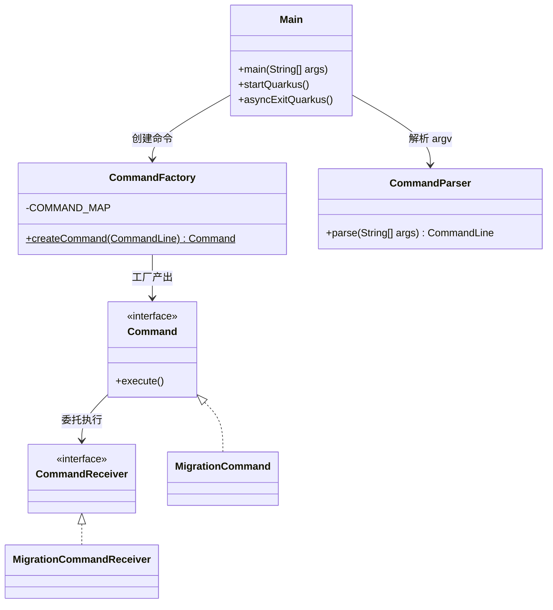
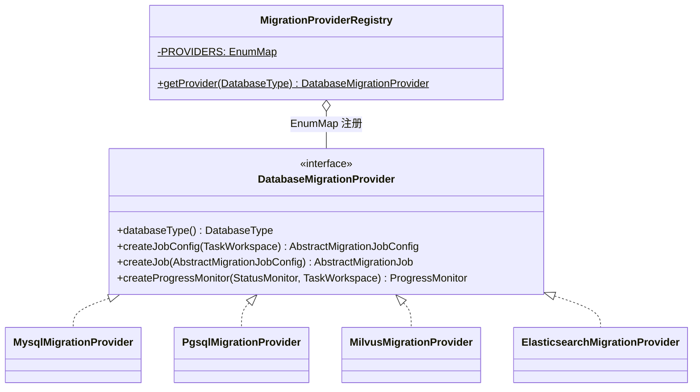
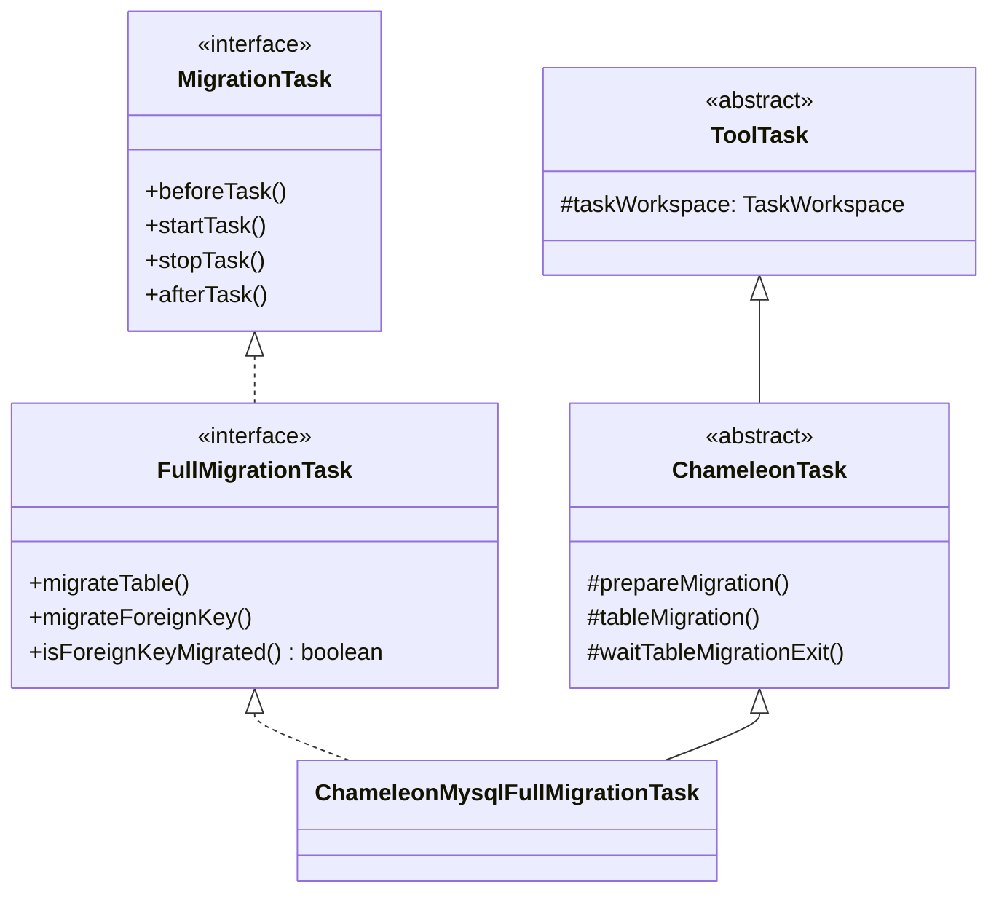
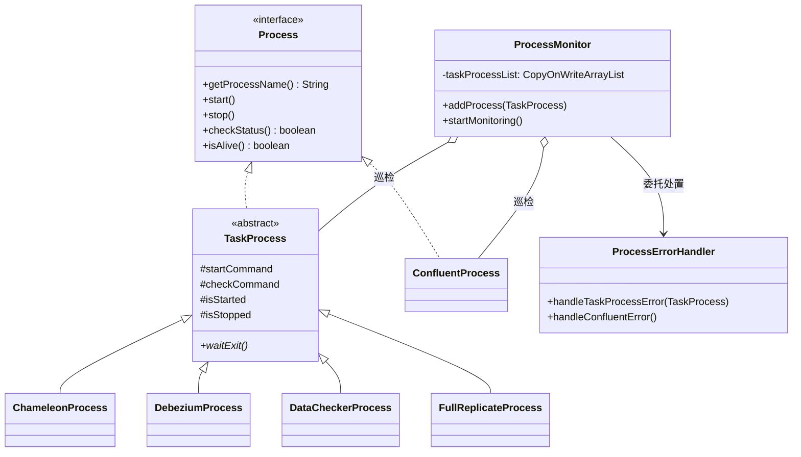
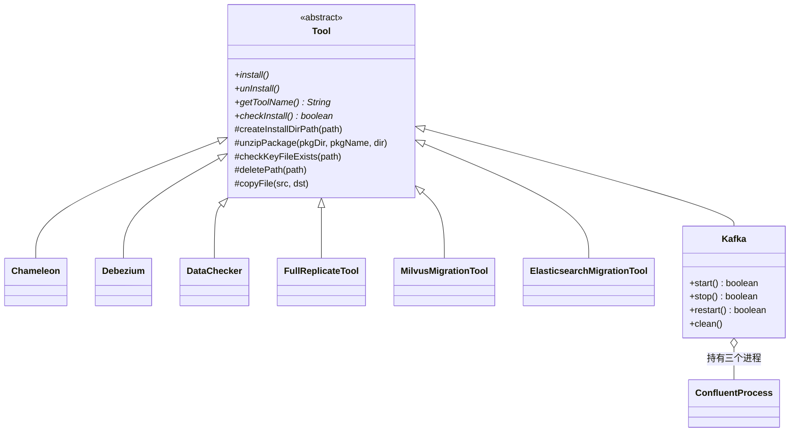

# 3 核心代码模块

> - 本章按模块讲解 portal 的核心代码：每个模块讲清"有什么、如何协作、为什么这样组织、如何扩展"。
> - 六大模块的调用链主线：CLI（portal-main）→ MigrationManager → Job（job/）→ Task（tasks/）→ Process（process/）→ 外部工具二进制（tools/ 负责安装与生命周期）。
> - 涉及的代码路径均相对 `multidb-portal/` 目录。

## 3.1 portal-main：CLI 模块

**模块定位**：进程入口 + 命令层。负责命令解析、分发、执行与迁移模板资源承载，不含迁移业务逻辑（业务全部委托 portal-migration / portal-common）；上游对接用户终端，下游 Receiver 调用迁移模块。该模块同时承载两种进程角色（见 2.3）：CLI 短命进程与 Quarkus 常驻迁移主进程共用同一个 Main 入口。

**包结构与类清单**（[portal-main/src/main/java/org/opengauss/](../portal-main/src/main/java/org/opengauss/)）：

- [Main.java](../portal-main/src/main/java/org/opengauss/Main.java)：`@QuarkusMain` 进程入口。`main()` 第一时间挂 [PortalExceptionHandler](../portal-common/src/main/java/org/opengauss/handler/PortalExceptionHandler.java) 全局兜底，随后解析并执行命令；持有 `startQuarkus()` / `asyncExitQuarkus()` 两个静态方法桥接 Quarkus（见 2.3/2.8）：

```java
@QuarkusMain
public class Main {
    public static void main(String[] args) {
        Thread.currentThread().setUncaughtExceptionHandler(new PortalExceptionHandler());
        Main.args = args;
        Command command = parseCommand(args);
        if (command != null) {
            command.execute();
        }
    }

    public static void startQuarkus() {
        Quarkus.run(args);          // 同一 JVM 切换为常驻迁移主进程角色
    }

    public static void asyncExitQuarkus() {
        Quarkus.asyncExit();        // 退出回调最终指向这里
    }
}
```

- [command/Command.java](../portal-main/src/main/java/org/opengauss/command/Command.java)：命令顶层接口，仅一个 `void execute()`。7 个实现类 = 7 类主命令（Task/Migration/Install/Uninstall/Mode/Kafka/Help）。
- [command/CommandFactory.java](../portal-main/src/main/java/org/opengauss/command/CommandFactory.java)：静态 `COMMAND_MAP` 分发 + 私有工厂方法做参数个数校验：

```java
private static final Map<String, Function<CommandLine, Command>> COMMAND_MAP = Map.of(
        "help", CommandFactory::generateHelpCommand,
        "install", CommandFactory::generateInstallCommand,
        "uninstall", CommandFactory::generateUninstallCommand,
        "kafka", CommandFactory::generateKafkaCommand,
        "mode", CommandFactory::generateModeCommand,
        "task", CommandFactory::generateTaskCommand,
        "migration", CommandFactory::generateMigrationCommand
);

public static Command createCommand(CommandLine cmd) {
    for (Map.Entry<String, Function<CommandLine, Command>> entry : COMMAND_MAP.entrySet()) {
        if (cmd.hasOption(entry.getKey())) {
            return entry.getValue().apply(cmd);
        }
    }
    throw new IllegalArgumentException("Invalid command");
}
```

- [command/parser/CommandParser.java](../portal-main/src/main/java/org/opengauss/command/parser/CommandParser.java)：commons-cli Options 定义（短/长选项、参数个数）与解析。
- [command/printer/TablePrinter.java](../portal-main/src/main/java/org/opengauss/command/printer/TablePrinter.java)：`task list` 等表格化输出。
- [command/receiver/](../portal-main/src/main/java/org/opengauss/command/receiver/)：`CommandReceiver` 标记接口 + 7 个按命令域拆分的 Receiver（实际业务逻辑），其中 [MigrationCommandReceiver](../portal-main/src/main/java/org/opengauss/command/receiver/MigrationCommandReceiver.java) 同时包含"切换进程角色"与"发送控制请求"两类逻辑。
- 资源文件（[src/main/resources/](../portal-main/src/main/resources/)）：`config/` 下 mysql/pgsql/elasticsearch/milvus 四库迁移配置模板（`task create` 时拷入任务目录），`mode/mode-template.properties`（`mode` 命令导出的自定义模式填写模板）。

**类关系图**：命令模式五层结构——



**典型流程走读**：两个对比场景，呈现"一套命令架构承载两种进程角色"。

场景① `migration start`（控制类命令 + 进程角色切换，最能体现 CLI 与 Quarkus 的桥接设计）。[MigrationCommandReceiver.start()](../portal-main/src/main/java/org/opengauss/command/receiver/MigrationCommandReceiver.java#L52-L70)：

```java
public void start() {
    TaskWorkspaceManager workspaceManager = new TaskWorkspaceManager();
    TaskWorkspace taskWorkspace = new TaskWorkspace(taskId);

    if (workspaceManager.isTaskRunning(taskWorkspace)) {      // ① 心跳文件判定任务是否已在运行
        LOGGER.error("Task {} is already running", taskId);
        return;
    }

    if (workspaceManager.checkTaskIdExists(taskId)) {         // ② 任务目录存在性校验
        MigrationContext.initialize(taskWorkspace);            // ③ 装配组件容器（见 2.10）
        MigrationManager.getInstance().registerExitCallback(Main::asyncExitQuarkus);  // ④ 注册退出回调
        setQuarkusPort(taskWorkspace);                         // ⑤ 端口协商并写入 port 文件（见 2.5）
        setQuarkusVertxCacheDir(taskWorkspace);                // ⑥ vertx 缓存目录指向任务 tmp（见 2.4）
        Main.startQuarkus();                                   // ⑦ Quarkus.run，同 JVM 切换为常驻角色
    } else {
        LOGGER.error("Task {} does not exist", taskId);
    }
}
```

值得注意的是 `setQuarkusPort`：CLI 进程从 6000 起探测可用端口，`System.setProperty("quarkus.http.port", ...)` 注入后写入任务目录下的 port 文件并设为只读——控制类命令随后靠读这个文件找到主进程（见 2.5）。

场景② `task list`（查询类短命进程链路）：命令解析 → TaskCommandReceiver → TaskWorkspaceManager 遍历 `workspace/` 任务目录（读 status/ 目录与心跳文件，不发起网络请求）→ TablePrinter 表格输出 → 进程退出。

对比两个场景可以看到：**控制类命令走 localhost HTTP、查询类直读状态文件**，这是 2.3 中 IPC 双链路设计在 CLI 层的落点；控制类命令的其余操作（stop/reverse/restart 等）均通过 [sendRequest](../portal-main/src/main/java/org/opengauss/command/receiver/MigrationCommandReceiver.java) 拼接 `curl -X POST http://localhost:{port}/task/{api}` 子进程发给主进程 REST 接口。

**关键实现细节**：

- 参数校验收敛于 CommandFactory 私有工厂方法（如 `migration` 强制要求恰好两个参数：operation + taskId），Command 实现类假设参数已合法；
- 解析失败（ParseException / 非法命令）记录错误后执行 HelpCommand 引导用户，而非打印堆栈直接退出；
- `Main.main()` 第一时间挂 PortalExceptionHandler，任何未捕获异常统一走全局兜底。

**设计动机**：命令解析与执行解耦（命令模式）。若全部塞进 main 方法，每新增一个命令都要修改核心入口；拆为 Parser/Factory/Command/Receiver 四层后，新增命令仅需在固定四处扩展，Main 与既有命令零改动。

**扩展指引**：新增命令 = CommandParser 加 Option 定义 + CommandFactory 加 COMMAND_MAP 映射与工厂方法 + 新建 Command 实现类 + 新建 Receiver 类。

## 3.2 portal-migration provider/：装配工厂

**模块定位**：按源库类型装配全套迁移组件的唯一工厂入口。屏蔽"不同源库用什么 JobConfig/Job/ProgressMonitor"的分支判断——[MigrationContext](../portal-migration/src/main/java/org/opengauss/migration/MigrationContext.java) 初始化只依赖接口，不感知任何具体源库实现（见 2.10）。

**包结构与类清单**（[portal-migration/src/main/java/org/opengauss/migration/provider/](../portal-migration/src/main/java/org/opengauss/migration/provider/)）：

- [DatabaseMigrationProvider.java](../portal-migration/src/main/java/org/opengauss/migration/provider/DatabaseMigrationProvider.java)：SPI 接口，每个源库类型一个实现：

```java
public interface DatabaseMigrationProvider {
    DatabaseType databaseType();                          // 声明服务的源库类型

    AbstractMigrationJobConfig createJobConfig(TaskWorkspace taskWorkspace);
    AbstractMigrationJob createJob(AbstractMigrationJobConfig jobConfig);
    ProgressMonitor createProgressMonitor(StatusMonitor statusMonitor, TaskWorkspace taskWorkspace);

    default void generateToolsConfigFiles(TaskWorkspace taskWorkspace) {
        createJobConfig(taskWorkspace).generateToolsConfigFiles();   // task create 时委托 JobConfig 生成工具配置
    }
}
```

- [MigrationProviderRegistry.java](../portal-migration/src/main/java/org/opengauss/migration/provider/MigrationProviderRegistry.java)：final 注册表，类加载时静态注册 4 个实现，EnumMap 存储：

```java
private static final Map<DatabaseType, DatabaseMigrationProvider> PROVIDERS = new EnumMap<>(DatabaseType.class);

static {
    register(new MysqlMigrationProvider());
    register(new PgsqlMigrationProvider());
    register(new MilvusMigrationProvider());
    register(new ElasticsearchMigrationProvider());
}

public static DatabaseMigrationProvider getProvider(DatabaseType databaseType) {
    DatabaseMigrationProvider provider = PROVIDERS.get(databaseType);
    if (provider == null) {
        throw new MigrationException("Unsupported source database type: " + databaseType);
    }
    return provider;
}
```

- 4 个实现类：Mysql/Pgsql/Milvus/Elasticsearch MigrationProvider。

**类关系图**：



**典型流程走读**（一次 Registry 查询如何产出成套组件）：`migration start` 触发的 MigrationContext.initialize 全链——

```
TaskHelper.loadSourceDbType(taskWorkspace)          // 读任务目录确定源库类型
  → MigrationProviderRegistry.getProvider(sourceDbType)
      → provider.createProgressMonitor(statusMonitor, taskWorkspace)
      → provider.createJobConfig(taskWorkspace) → jobConfig.loadConfig()
      → provider.createJob(jobConfig)
```

以 [MysqlMigrationProvider](../portal-migration/src/main/java/org/opengauss/migration/provider/MysqlMigrationProvider.java#L30-L41) 为例：

```java
@Override
public AbstractMigrationJobConfig createJobConfig(TaskWorkspace taskWorkspace) {
    return new MysqlMigrationJobConfig(taskWorkspace);
}

@Override
public AbstractMigrationJob createJob(AbstractMigrationJobConfig jobConfig) {
    if (!(jobConfig instanceof MysqlMigrationJobConfig)) {
        throw new IllegalArgumentException("Invalid job config type for MysqlMigrationProvider");
    }
    return new MysqlMigrationJob((MysqlMigrationJobConfig) jobConfig);
}
```

这条链说明 Provider 的语义是"**按类型取一套**"（JobConfig + Job + ProgressMonitor 三件组件），而非"按类型取一个类"。

**关键实现细节**：

- `createJob` 内 instanceof 校验传入 JobConfig 的类型匹配——若某 Provider 被传入别库的 JobConfig，立即抛异常而非产出错配的 Job；
- `generateToolsConfigFiles` 用 default 方法委托 JobConfig 实现，Provider 不必重复实现"生成工具配置文件"逻辑。

**设计动机**：没有 Provider 时，MigrationContext.initialize 需要按 DatabaseType 写 if-else 分支装配组件，新增源库类型要改动核心装配代码；引入 Provider + Registry 后，**新增源库类型 = 新增 Provider 实现 + Registry 注册一行**，装配逻辑不扩散到 Context。

**扩展指引**：新增源库的 Provider 实现要点（JobConfig/Job/ProgressMonitor 三件套的产出与类型防错配。

## 3.3 portal-migration job/ + job/config/：编排与配置

**模块定位**：编排与控制中枢。Job 管"阶段编排与迁移控制"（每个源库一个 Job 子类），JobConfig 管"配置装载与工具配置文件生成"（每个源库一个 JobConfig 子类），每个源库一对实现，共 4 对。

**包结构与类清单**：

- [AbstractMigrationJob.java](../portal-migration/src/main/java/org/opengauss/migration/job/AbstractMigrationJob.java)（编排骨架）：
  - 5 个阶段开关字段（`hasFullMigration` 等，构造时从 JobConfig 拷贝缓存，运行期不变）+ 5 个阶段 Task 字段；
  - 11 个公共抽象控制方法：`preMigrationVerify` / `beforeTask` / `startTask` / `stopTask` + 增量、反向各自的 stop / resume / restart；
  - 2 个包内抽象方法：`generateTasks`（按开关实例化任务）/ `afterTask`（善后）；
  - 公共能力 `adjustKernelFsyncParam`：迁移期间关闭目标库 fsync 提升写入性能，结束恢复：

- [AbstractMigrationJobConfig.java](../portal-migration/src/main/java/org/opengauss/migration/job/config/AbstractMigrationJobConfig.java)（配置装载骨架）：
  - `migrationConfigFile`（迁移配置文件对象，模板类型由子类构造传入）；
  - `migrationPhaseList` 懒加载：首次调用按 `migration.mode` 经 ModeManager 解析阶段列表（衔接 2.14）：
  - 5 个 `hasXxx()` 布尔缓存（volatile，首次调用才解析阶段列表）+ 4 个抽象方法：`loadConfig`（装载）/ `changeToolsConfig`（改写工具配置）/ `saveChangeConfig`（回写）/ `generateToolsConfigFiles`（生成）。
  - 4 对子类：Mysql/Pgsql/Milvus/Elasticsearch 的 MigrationJob + MigrationJobConfig。以 MySQL 为例：[MysqlMigrationJob](../portal-migration/src/main/java/org/opengauss/migration/job/MysqlMigrationJob.java)、[MysqlMigrationJobConfig](../portal-migration/src/main/java/org/opengauss/migration/job/config/MysqlMigrationJobConfig.java)。

**典型流程走读**（两个场景）：

场景① plan2（全量+增量）的 `startTask` 编排——展示"**阶段开关如何变成步骤链**"。MysqlMigrationJob.startTask 的三步：`changePhasesConfig`（按阶段回写配置）→ `generateTasks`（按阶段实例化任务）→ `getTaskExecutor` 组装 [TaskAssistantExecutor](../portal-migration/src/main/java/org/opengauss/migration/executor/TaskAssistantExecutor.java) 步骤链（衔接 2.12）：

```java
private TaskAssistantExecutor getTaskExecutor(
        MigrationStopIndicator migrationStopIndicator, StatusMonitor statusMonitor) {
    TaskAssistantExecutor executor = new TaskAssistantExecutor(migrationStopIndicator);
    if (hasFullMigration) {                                   // 全量步骤：状态切换 + 建表迁移
        executor.addStep(() -> {
            statusMonitor.setCurrentStatus(MigrationStatusEnum.START_FULL_MIGRATION);
            fullMigrationTask.beforeTask();
            statusMonitor.setCurrentStatus(MigrationStatusEnum.FULL_MIGRATION_RUNNING);
            fullMigrationTask.migrateTable();
        });
    }
    if (hasIncrementalMigration) {                            // 增量 source 先行（订阅 binlog/WAL）
        executor.addStep(() -> {
            incrementalMigrationTask.beforeTask();
            incrementalMigrationTask.startSource();
        });
    }
    // ... 对象迁移、外键迁移、全量校验、增量启动、增量校验等步骤按开关依次 addStep
    executor.execute();
}
```

每个步骤内部完成一次状态切换（START_xxx → xxx_RUNNING → xxx_FINISHED），步骤粒度即 2.12 所述的协作式停止粒度。`generateTasks` 的实例化与 ConfigBundle 注入一一对应：

```java
if (hasFullMigration) {
    fullMigrationTask = new ChameleonMysqlFullMigrationTask(taskWorkspace, migrationStopIndicator,
            migrationJobConfig.getFullConfigBundle());
}
if (hasFullDataCheck) {
    fullDataCheckTask = new DataCheckerMysqlFullDataCheckTask(processMonitor, migrationStopIndicator,
            taskWorkspace, migrationConfigDto, migrationJobConfig.getFullDataCheckConfigBundle());
}
// ... 增量迁移/增量校验/反向同理
```

场景② `stopIncremental` 的状态守卫——展示"**控制方法 = 开关检查 + 状态守卫 + 动作序列**"的统一模式：

```java
public synchronized void stopIncremental(
        MigrationStopIndicator migrationStopIndicator, StatusMonitor statusMonitor) {
    if (!hasIncrementalMigration) {                           // ① 阶段开关检查
        LOGGER.warn("No incremental migration phase, unable to stop incremental migration");
        return;
    }
    MigrationStatusEnum currentStatus = statusMonitor.getCurrentStatus().getStatus();
    if (!currentStatus.equals(MigrationStatusEnum.INCREMENTAL_MIGRATION_RUNNING)
            && !currentStatus.equals(MigrationStatusEnum.INCREMENTAL_MIGRATION_INTERRUPTED)) {
        LOGGER.warn("Can not stop incremental migration, ...");   // ② 迁移状态前置校验
        return;
    }
    statusMonitor.setCurrentStatus(MigrationStatusEnum.INCREMENTAL_MIGRATION_STOPPING);  // ③ 进入中间态
    if (hasIncrementalDataCheck) {
        incrementalDataCheckTask.stopTask();                  // ④ 先停增量校验
    }
    incrementalMigrationTask.stopTask();                      // ⑤ 再停增量迁移
    if (hasFullMigration && !fullMigrationTask.isForeignKeyMigrated()) {
        fullMigrationTask.migrateForeignKey();                // ⑥ 外键未迁移则补迁（增量期外键延迟迁移）
    }
    if (!migrationStopIndicator.isStopped() && hasReverseMigration && !hasDoBeforeReverse) {
        reverseMigrationTask.beforeTask();                    // ⑦ 未做反向准备则补做（创建publication等）
        hasDoBeforeReverse = true;
    }
    statusMonitor.setCurrentStatus(MigrationStatusEnum.INCREMENTAL_MIGRATION_FINISHED);
}
```

注意 `hasDoBeforeReverse` 标记防止反向准备动作被重复执行；`stopTask`（全任务停止）同样按阶段开关逐 Task 停止并善后。四个库的 Job 实现同构，掌握 MySQL 版即可举一反三。

**关键实现细节**：

- 阶段开关字段在 Job 构造时从 JobConfig 拷贝缓存，运行期只读；
- JobConfig.loadConfig 按阶段开关只加载开启阶段的 ConfigBundle（见 [MysqlMigrationJobConfig.loadConfig](../portal-migration/src/main/java/org/opengauss/migration/job/config/MysqlMigrationJobConfig.java#L65-L92)）：

```java
public void loadConfig() {
    migrationConfigFile.loadConfigMap();
    migrationConfigDto = MysqlMigrationConfig.generateMysqlMigrationConfigDto(
            migrationConfigFile.getConfigMap());
    if (hasFullMigration()) {
        fullConfigBundle.loadConfigMap();                     // full → Chameleon 配置束
    }
    if (hasFullDataCheck()) {
        fullDataCheckConfigBundle.loadConfigMap();            // 全量校验 → DataChecker 配置束
    }
    if (hasIncrementalMigration()) {
        incrementalConfigBundle.loadConfigMap();              // 增量 → Debezium 配置束
        if (hasIncrementalDataCheck()) {
            incrementalDataCheckConfigBundle.loadConfigMap();
        }
    }
    if (hasReverseMigration()) {
        reverseConfigBundle.loadConfigMap();
    }
}
```

- ConfigBundle 按工具划分：SingleConfigBundle（Chameleon 单文件）、DataCheckerConfigBundle（check/sink/source/log4j2 四文件）、DebeziumConfigBundle（connect/worker/log4j × source/sink 六文件）；每个 Bundle 的 ConfigFile 带模板类型，`generateToolsConfigFiles` 据此从模板生成任务目录配置文件；
- `hasXxx` 布尔缓存 volatile + 懒加载，避免重复解析阶段列表。

**设计动机**：编排与配置职责分离。Job 只关心"哪些阶段开启、按什么顺序编排"，配置的装载/改写/生成全部收敛在 JobConfig；阶段开关贯穿两者——未开启的阶段不加载配置、不创建任务、不编排步骤，三者保持一致。

**扩展指引**：新增源库 = 实现 Job（11 个控制方法 + generateTasks/afterTask）+ JobConfig（4 个方法 + ConfigBundle 装配）+ Provider 挂接。

## 3.4 portal-migration tasks/：迁移任务实现

**模块定位**：迁移动作的最终执行者。阶段能力（phase 接口）与工具执行方式（tool 基类）正交分解，impl/ 组合类只是薄装配层。

**包结构与类清单**（[portal-migration/src/main/java/org/opengauss/migration/tasks/](../portal-migration/src/main/java/org/opengauss/migration/tasks/)）：

- [MigrationTask.java](../portal-migration/src/main/java/org/opengauss/migration/tasks/MigrationTask.java)：顶层接口，生命周期四方法 `beforeTask` / `startTask` / `stopTask` / `afterTask`。
- [phase/](../portal-migration/src/main/java/org/opengauss/migration/tasks/phase/) 5 个阶段接口（继承 MigrationTask，细化阶段能力）：
  - [FullMigrationTask.java](../portal-migration/src/main/java/org/opengauss/migration/tasks/phase/FullMigrationTask.java)：`migrateTable` / `migrateObject` / `migrateForeignKey` 三个迁移动作 + 六个迁移状态查询（isTable/Trigger/View/Function/Procedure/ForeignKeyMigrated，供停止增量时判断外键是否补迁、供状态查询使用）；阶段性的 `startTask` 默认抛 UnsupportedOperationException——全量迁移的启动入口被 Job 编排拆成多个细粒度方法，不走统一 startTask：

```java
public interface FullMigrationTask extends MigrationTask {
    @Override
    default void startTask() {
        throw new UnsupportedOperationException("Start task method is not supported");
    }
    void migrateTable();
    void migrateObject();
    void migrateForeignKey();
    boolean isTableMigrated();
    // ... isTriggerMigrated / isViewMigrated / isFunctionMigrated / isProcedureMigrated / isForeignKeyMigrated
}
```

  - [IncrementalMigrationTask.java](../portal-migration/src/main/java/org/opengauss/migration/tasks/phase/IncrementalMigrationTask.java)：source/sink 四个启停方法 + `resumeTask`；默认 `startTask = startSink + startSource`（先启 sink 保证数据落地通道就绪）、默认 `stopTask = stopSource + stopSink`（先停 source 切断数据来源）：

```java
public interface IncrementalMigrationTask extends MigrationTask {
    @Override
    default void startTask() {
        startSink();
        startSource();
    }
    void startSource();
    void startSink();
    void stopSource();
    void stopSink();
    void resumeTask();

    @Override
    default void stopTask() {
        stopSource();
        stopSink();
    }
}
```

  - FullDataCheckTask / IncrementalDataCheckTask / ReverseMigrationTask：其余三个阶段接口。
- [tool/](../portal-migration/src/main/java/org/opengauss/migration/tasks/tool/) 工具任务基类：[ToolTask](../portal-migration/src/main/java/org/opengauss/migration/tasks/ToolTask.java)（持 taskWorkspace）→ ChameleonTask / DebeziumTask / DataCheckerTask / FullReplicateTask / MilvusMigrationToolTask / ElasticsearchMigrationToolTask。
- [impl/](../portal-migration/src/main/java/org/opengauss/migration/tasks/impl/) 10 个组合类 = 工具 × 源库 × 阶段。

**正交矩阵**（本模块的核心结构，10 个组合类的来源一目了然）：

| tool/ 工具基类 | phase/ 阶段接口 | impl/ 组合类 |
|---------------|----------------|-------------|
| ChameleonTask | FullMigrationTask | ChameleonMysqlFullMigrationTask |
| FullReplicateTask | FullMigrationTask | FullReplicatePgsqlFullMigrationTask |
| MilvusMigrationToolTask | FullMigrationTask | MilvusMigrationToolFullMigrationTask |
| ElasticsearchMigrationToolTask | FullMigrationTask | ElasticsearchMigrationToolFullMigrationTask |
| DataCheckerTask | FullDataCheckTask | DataCheckerMysqlFullDataCheckTask |
| DataCheckerTask | IncrementalDataCheckTask | DataCheckerMysqlIncrementalDataCheckTask |
| DebeziumTask | IncrementalMigrationTask | DebeziumMysqlIncrementalMigrationTask / DebeziumPgsqlIncrementalMigrationTask |
| DebeziumTask | ReverseMigrationTask | DebeziumMysqlReverseMigrationTask / DebeziumPgsqlReverseMigrationTask |

**类关系图**（精简为一条继承链示例，其余组合同理）：



**典型流程走读**（两个场景，覆盖"批量子命令编排"与"流式双进程编排"两种形态）：

场景① ChameleonTask 全量迁移完整生命周期。[ChameleonTask.java](../portal-migration/src/main/java/org/opengauss/migration/tasks/tool/ChameleonTask.java) 把 pg_chameleon 的一组子命令编排成全量迁移流程：

```
prepareMigration     清理历史文件 → 准备配置文件 → drop/create replica schema、add source
                     （三个前置子命令，前台启动并等待退出）
tableMigration       init replica 子命令后台启动不等待（长时间建表迁移）
waitTableMigrationExit  轮询等待 init replica 退出并校验状态（可与对象迁移并行编排）
migrateObject        trigger / view / function / procedure 逐个前台启动并等待退出
migrateForeignKey    detach replica（分离回放链路后迁移外键），失败抛异常
afterMigration       drop replica schema + 清理 json 状态文件
```

所有"前台等待"路径收敛到同一个私有方法，内置停止旗标检查（衔接 2.13）与退出状态校验：

```java
private void startProcessAndWaitExit(TaskProcess process) {
    if (!migrationStopIndicator.isStopped()) {        // 启动前检查全局停止旗标
        currentProcess = process;
        process.start();
        process.waitExit();
        if (!process.checkStatus()) {                 // 退出后校验日志判定是否正常
            throw new MigrationException(
                    process.getProcessName() + " exit abnormally, please check the log for details.");
        }
    }
}
```

场景② DebeziumTask source/sink 双进程模型。[DebeziumTask.java](../portal-migration/src/main/java/org/opengauss/migration/tasks/tool/DebeziumTask.java) 持有 6 个 ConfigFile（connect/worker/log4j × source/sink）与双进程引用：

```java
private DebeziumProcess sourceProcess;
private DebeziumProcess sinkProcess;
private int sourcePort = 8083;      // source connect REST 端口
private int sinkPort = 8084;        // sink connect REST 端口

protected abstract DebeziumProcess generateSourceProcess();   // 由子类按源库产出
protected abstract DebeziumProcess generateSinkProcess();
protected abstract void beforeSourceProcess();                // 启动前钩子（如等待 Kafka 就绪）
protected abstract void beforeSinkProcess();
```

source 进程订阅源库变更写入 Kafka，sink 进程从 Kafka 消费写入 openGauss——增量与反向迁移复用同一基类，仅配置模板与进程参数不同。启停顺序由 phase 接口默认实现约束（先 sink 后 source 启动、先 source 后 sink 停止）。

**关键实现细节**：

- `startProcessAndWaitExit` 启动前检查 MigrationStopIndicator（全局停止旗标，见 2.13），停止后不再启动后续子命令；
- `waitTableMigrationExit` 校验依据是日志末行包含 `<order> finished`（对应 ChameleonProcess.checkStatus）；
- `tableMigration` 后台启动 + `waitTableMigrationExit` 单独暴露——Job 编排借此把"等待建表完成"与"迁移对象"拆成两个步骤；
- IncrementalMigrationTask 默认先 sink 后 source 启动、先 source 后 sink 停止，保证流通道始终"先收后放"。

**设计动机**：阶段能力与工具执行方式正交分解。若不做正交，10 个组合场景需要 10 个独立大类，工具内部逻辑（子命令编排、双进程管理）在各类间复制；正交后工具逻辑收敛在 6 个基类，阶段契约收敛在 5 个接口，组合类只做"继承工具基类 + 实现阶段接口 + 填配置"的薄装配。新阶段加接口、新库/新工具各实现基类即可。

**扩展指引**：新增工具 = tool 基类 + Process（3.5）+ Tool（3.6）三件套；新增阶段 = phase 接口 + 各工具基类实现。

## 3.5 portal-migration process/：子进程管理

**模块定位**：子进程统一抽象 + 守护巡检 + 按工具分级的异常处置。portal 以子进程方式驱动全部迁移工具（见 1.6.3），本模块是"工具进程"的运行时容器：向上承接 tasks/ 的启动/等待请求，向下屏蔽"启动命令、查活、停止、异常判定"的操作系统细节。

**包结构与类清单**（[portal-migration/src/main/java/org/opengauss/migration/process/](../portal-migration/src/main/java/org/opengauss/migration/process/)）：

- [Process.java](../portal-migration/src/main/java/org/opengauss/migration/process/Process.java)：进程顶层接口，五方法——`getProcessName` / `start` / `stop` / `checkStatus` / `isAlive`。
- [task/TaskProcess.java](../portal-migration/src/main/java/org/opengauss/migration/process/task/TaskProcess.java)：任务进程抽象基类，持四项构造注入事实（processName / taskWorkspace / startCommand / checkCommand）+ 三个状态字段（volatile `isStarted` / `isStopped`、`isNormal`）+ 一个抽象方法 `waitExit()`：
- task/ 下 6 个工具进程实现，与 tools/ 的工具一一对应：[ChameleonProcess](../portal-migration/src/main/java/org/opengauss/migration/process/task/ChameleonProcess.java)、[DebeziumProcess](../portal-migration/src/main/java/org/opengauss/migration/process/task/DebeziumProcess.java)、[DataCheckerProcess](../portal-migration/src/main/java/org/opengauss/migration/process/task/DataCheckerProcess.java)、[FullReplicateProcess](../portal-migration/src/main/java/org/opengauss/migration/process/task/FullReplicateProcess.java)、[MilvusMigrationToolProcess](../portal-migration/src/main/java/org/opengauss/migration/process/task/MilvusMigrationToolProcess.java)、[ElasticsearchMigrationToolProcess](../portal-migration/src/main/java/org/opengauss/migration/process/task/ElasticsearchMigrationToolProcess.java)。
- [ConfluentProcess.java](../portal-migration/src/main/java/org/opengauss/migration/process/ConfluentProcess.java)：Kafka 三进程（zookeeper / kafka / schema registry）的包装，直接实现 Process（不经 TaskProcess——它没有 TaskWorkspace，也不参与任务级启停编排）。
- [ProcessMonitor.java](../portal-migration/src/main/java/org/opengauss/migration/process/ProcessMonitor.java)：守护线程 `Process-Monitor-Thread`，500ms 轮询一轮，持有 `ProcessErrorHandler`。
- [ProcessErrorHandler.java](../portal-migration/src/main/java/org/opengauss/migration/process/ProcessErrorHandler.java)：按工具语义分级的异常处置器。

**类关系图**：



**典型流程走读**（三个场景递进：单进程生命周期 → 守护巡检 → 异常处置分流）：

场景① TaskProcess 生命周期——启动、查活、等待、停止。[TaskProcess.java](../portal-migration/src/main/java/org/opengauss/migration/process/task/TaskProcess.java) 的关键事实是 **checkCommand 双用途**：它既是启动命令的指纹片段，也是查 pid 的依据：

```java
public boolean isAlive() {
    int commandPid = ProcessUtils.getCommandPid(checkCommand);  // 按命令片段反查 pid
    pid = commandPid;
    return pid != -1;
}

public void stop() {
    if (!isStopped || isAlive()) {
        isStopped = true;
        ProcessUtils.killProcessByCommandSnippet(checkCommand, false);  // 软 kill
        waitProcessExit();      // 每秒查活，最长等 5 秒
    }
}

private void waitProcessExit() {
    // 5 秒内每秒检查一次，仍未退出 → killProcessByCommandSnippet(checkCommand, true) 强杀
    // 强杀后仍存活 → LOGGER.error("Failed to stop {}, please kill it manually, pid: {}", ...)
}
```

`checkStatus` 由各工具实现差异化判定。以 [ChameleonProcess](../portal-migration/src/main/java/org/opengauss/migration/process/task/ChameleonProcess.java) 为例——前台命令退出后读日志末行判定是否正常完成：

```java
public boolean checkStatus() {
    if (!isStarted || isStopped) {
        return isNormal;
    }
    if (!isAlive() && !isStopped) {
        String lastLine = FileUtils.readFileLastLine(logPath);
        String endFlag = chameleonOrder + " finished";   // 如 "init finished"
        isStopped = true;
        isNormal = lastLine.contains(endFlag);           // 含结束标记才算正常退出
    }
    return isNormal;
}

public void waitExit() {   // 前台等待：每秒轮询一次 checkStatus
    while (isStarted && !isStopped) {
        ThreadUtils.sleep(1000);
        checkStatus();
    }
}
```

对比 [DebeziumProcess](../portal-migration/src/main/java/org/opengauss/migration/process/task/DebeziumProcess.java)：常驻进程没有"退出"语义，`checkStatus` 只判定 `isAlive`（不读日志），且 `waitExit` 直接抛 `UnsupportedOperationException`——它由 ProcessMonitor 而非 Task 编排来管理。

场景② ProcessMonitor 巡检一轮的判定树。[ProcessMonitor.java](../portal-migration/src/main/java/org/opengauss/migration/process/ProcessMonitor.java) 以 500ms 为周期循环执行：

```java
for (TaskProcess taskProcess : taskProcessList) {
    if (!taskProcess.checkStatus()) {                    // ① 状态检查失败
        taskProcessList.remove(taskProcess);
        processErrorHandler.handleTaskProcessError(taskProcess);
        break;
    }
    if (taskProcess.isStopped()) {                       // ② 正常停止 → 静默移除
        taskProcessList.remove(taskProcess);
    }
    if (!isProcessFunctional(taskProcess)) {             // ③ 功能性失效
        taskProcessList.remove(taskProcess);
        taskProcess.stop();
        processErrorHandler.handleTaskProcessError(taskProcess);
        break;
    }
}

if (statusMonitor.isFullMigrationStatus() || statusMonitor.isNotRunning()) {
    continue;   // 全量迁移 / 非运行状态不依赖 Kafka，跳过 Confluent 巡检
}
for (ConfluentProcess confluentProcess : confluentProcessList) {
    if (!confluentProcess.checkStatus()) {
        processErrorHandler.handleConfluentError();
        break;
    }
}
```

判定树中第 ③ 条"功能性失效"是针对 Debezium 的补充巡检：进程活着但可能已经"不干活了"。[ProcessMonitor.java](../portal-migration/src/main/java/org/opengauss/migration/process/ProcessMonitor.java) 按"增量/反向 × source/sink"定位各连接器的状态文件，连续 `MAX_NOT_MODIFIED_COUNT = 60` 轮（60 × 500ms = 30 秒）修改时间未变化即判定失效，先 `stop()` 再交异常处置。

场景③ ProcessErrorHandler 处置分流——错误按工具语义分级，而非一刀切终止迁移。[ProcessErrorHandler.java](../portal-migration/src/main/java/org/opengauss/migration/process/ProcessErrorHandler.java)：

```java
public void handleTaskProcessError(TaskProcess process) {
    if (process instanceof DataCheckerProcess) {
        // 数据校验不完整则迁移无意义 → 直接终止
        throw new MigrationException("Data checker process has exit abnormally, stop migration");
    }
    if (process instanceof DebeziumProcess) {
        // 流式迁移中断可恢复 → 置中断状态，等待用户恢复
        if (statusMonitor.isIncrementalMigrationStatus()) {
            statusMonitor.setCurrentStatus(MigrationStatusEnum.INCREMENTAL_MIGRATION_INTERRUPTED);
        }
        if (statusMonitor.isReverseMigrationStatus()) {
            statusMonitor.setCurrentStatus(MigrationStatusEnum.REVERSE_MIGRATION_INTERRUPTED);
        }
    }
}

public void handleConfluentError() {
    // Kafka 异常 → 自动重启 3 次，成功则自动续迁
    boolean isRestarted = Kafka.getInstance().restart();
    if (statusMonitor.isIncrementalMigrationStatus() && isRestarted
            && !statusMonitor.isIncrementalMigrationStopped()) {
        migrationManager.restartIncremental();
        return;
    }
    // ...反向迁移同理 restartReverse()；重试失败才抛 MigrationException
}
```

三种工具对应三种处置语义：DataChecker 异常 → 抛异常终止（校验数据不完整则迁移结果无意义）；Debezium 异常 → 置 INCREMENTAL/REVERSE_MIGRATION_INTERRUPTED 中断态（断点可续传，恢复即可继续）；数据教研时 Kafka 异常 -> 抛异常终止；增量或反向迁移时 Kafka 异常 → `restart()` 重试 3 次、间隔 5 秒，成功则 `restartIncremental()` / `restartReverse()` 自动续迁。

**关键实现细节**：

- `checkCommand` 双用途设计：一段命令指纹同时承担"启动参数"与"查 pid 依据"，进程不需要记录 PID 文件，`ProcessUtils.getCommandPid` 按指纹反查即可；
- ConfluentProcess 的 checkCommand 按主类名匹配（zookeeper → `QuorumPeerMain`、kafka → `SupportedKafka`、schema registry → `SchemaRegistryMain`），避免误杀同名进程；
- [ChameleonProcess.start()](../portal-migration/src/main/java/org/opengauss/migration/process/task/ChameleonProcess.java) 注入密码环境变量：`MysqlMigrationConfig.isUseInteractivePassword()` 为 true 时把源库/openGauss 密码放入进程 env，避免密码落盘；
- `taskProcessList` 用 `CopyOnWriteArrayList`：巡检线程遍历的同时业务线程会 `addProcess` 注册新进程/移除旧进程，写时复制保证两边不互相干扰；

**设计动机**：把"子进程"抽象成可监控、可停止、可分级的资源。若没有统一 Process 抽象，每个工具各自管理进程句柄——portal 无法感知进程死活（增量迁移可能静默中断数小时）；若异常处置一刀切终止迁移，Kafka 抖动这种可自动恢复的故障也会把用户长时间的全量+校验成果作废。分级处置的本质是：**按"该工具异常的可恢复性"决定处置策略**。

**扩展指引**：新工具接入 = 继承 TaskProcess 实现 `start` / `checkStatus` / `waitExit`（差异通常在"如何判定正常退出"）+ 在 Job 启动任务处调用 `ProcessMonitor.addProcess` 注册巡检 + 在 ProcessErrorHandler 补充分支。

## 3.6 portal-migration tools/：工具安装与生命周期

**模块定位**：外部工具的安装/卸载/运行期生命周期管理。portal 不依赖系统安装工具，portal 安装包内置各工具二进制（pkg/ 目录），install 命令统一解压安装到 tools/ 目录；工具对象为全局单例，保证"路径装配一次、进程状态全局一致"。

**包结构与类清单**（[portal-migration/src/main/java/org/opengauss/migration/tools/](../portal-migration/src/main/java/org/opengauss/migration/tools/)）：

- [Tool.java](../portal-migration/src/main/java/org/opengauss/migration/tools/Tool.java)：工具抽象基类。4 个抽象方法 `install` / `unInstall` / `getToolName` / `checkInstall` + 5 个 protected 模板方法 `createInstallDirPath` / `unzipPackage` / `checkKeyFileExists` / `deletePath` / `copyFile`——所有 IO 异常统一转 [InstallException](../portal-common/src/main/java/org/opengauss/exceptions/InstallException.java)。
- 7 个工具类（双检锁单例）：[Chameleon](../portal-migration/src/main/java/org/opengauss/migration/tools/Chameleon.java)、[Debezium](../portal-migration/src/main/java/org/opengauss/migration/tools/Debezium.java)、[DataChecker](../portal-migration/src/main/java/org/opengauss/migration/tools/DataChecker.java)、[FullReplicateTool](../portal-migration/src/main/java/org/opengauss/migration/tools/FullReplicateTool.java)、[MilvusMigrationTool](../portal-migration/src/main/java/org/opengauss/migration/tools/MilvusMigrationTool.java)、[ElasticsearchMigrationTool](../portal-migration/src/main/java/org/opengauss/migration/tools/ElasticsearchMigrationTool.java)、[Kafka](../portal-migration/src/main/java/org/opengauss/migration/tools/Kafka.java)。

**类关系图**：



**典型流程走读**（两个场景）：

场景① install 命令的幂等安装（以 [Chameleon.java](../portal-migration/src/main/java/org/opengauss/migration/tools/Chameleon.java) 为例，最能体现"模板方法 + 幂等"）。`install` 命令（见 3.1 InstallCommand）逐工具调用 `install()`：

```java
public void install() {
    if (checkInstall()) {                    // 已装则短路返回，重复执行安全
        LOGGER.info("Chameleon is already installed");
        return;
    }
    createInstallDirPath(installDirPath);    // 模板方法：建安装目录
    createInstallDirPath(pgChameleonDirPath);
    unzipPackage(pkgDirPath, pkgName, installDirPath);   // 模板方法：解压 pkg/ 内安装包
    String installScriptPath = chameleonHomeDirPath + "/install.sh";
    checkKeyFileExists(installScriptPath);   // 模板方法：关键文件存在性校验
    runInstallScript(installScriptName, installScriptPath);  // 执行 install.sh，超时 300 秒
    checkKeyFileExists(chameleonPath);       // 装后校验关键文件
    checkChameleonVersion();                 // 执行 --version 比对版本号
}
```

幂等的闭环在 `checkInstall`：它复用"关键文件存在 + 版本比对"两步校验，任何一步失败（抛 InstallException）即视为未安装返回 false——因此 install 中断后重跑会从断点重来，不会因目录已存在而失败。工具路径全部在构造器中从 Portal（pkg/ + tools/，见 2.1）+ [ChameleonConstants](../portal-common/src/main/java/org/opengauss/constants/tool/ChameleonConstants.java) 推导，构造后只读。

场景② Kafka 三进程启动序列（唯一常驻服务型工具）。[Kafka.java](../portal-migration/src/main/java/org/opengauss/migration/tools/Kafka.java) 的 install 完成后立即 `initKafka()` + `start()`。`initKafka` 用 [PortUtils](../portal-migration/src/main/java/org/opengauss/migration/utils/PortUtils.java) 为三个服务协商端口（kafka 默认 9092 / zookeeper 默认 2181 / schema registry 默认 8081，被占用则顺延）并写入配置文件；`start()` 按依赖顺序启动并逐一健康检查：

```java
public boolean start() {
    Properties portProperties = getKafkaPortProperties();

    ConfluentProcess zookeeper = getZookeeperProcess();
    if (zookeeper.isAlive()) { /* 已启动跳过 */ }
    else { zookeeper.start(); checkZookeeper(zookeeperPort); }   // 等 3 秒

    ConfluentProcess kafka = getKafkaProcess();
    if (kafka.isAlive()) { /* ... */ }
    else { kafka.start(); checkKafka(kafkaPort); }               // 等 10 秒

    ConfluentProcess registry = getSchemaRegistryProcess();
    if (registry.isAlive()) { /* ... */ }
    else { registry.start(); checkSchemaRegistry(schemaRegistryPort); }  // 等 8 秒

    if (三者全部 isAlive()) return true;
    LOGGER.error("Start all Kafka process failed, stop remaining processes");
    stopProcess(zookeeper); stopProcess(kafka); stopProcess(registry);   // 回滚已启进程
    return false;
}
```

三个进程包装为 [ConfluentProcess](../portal-migration/src/main/java/org/opengauss/migration/process/ConfluentProcess.java)（见 3.5），`startWaitTime` 分别是 `ZOOKEEPER_START_TIME = 3000` / `KAFKA_START_TIME = 10000` / `SCHEMA_REGISTRY_START_TIME = 8000` 毫秒。自动恢复路径在 3.5 场景③已见：`restart()` 重试 3 次、间隔 5 秒，每次先按 schema registry → kafka → zookeeper 的**逆序**停止再重新 `start()`。

**关键实现细节**：

- 各工具路径全部从 Portal（pkg/ + tools/ + data/ + logs/ + tmp/）+ 各工具 Constants 推导，构造器一次装配、此后只读（衔接 2.1"路径与环境事实来源"）；
- `checkInstall` 幂等语义：install / unInstall / start / stop / clean 全部先 `checkInstall` 短路，重复执行安全；
- Kafka 运维方法族（增量/反向迁移的数据通道维护）：`getKafkaTopics` / `deleteKafkaTopic`（清理迁移 topic）、`setSchemaCompatibilityToNone`（curl 置 schema 兼容模式为 NONE）、`getSchemaRegistryUrl` / `getKafkaIpPort` / `getZookeeperIpPort`（供 Debezium 配置）、`clean`（停止三进程并清 tmp 目录）、`getStatusDetail`（三进程存活明细，供 kafka 状态查询命令）；
- Kafka 单例内的三个 ConfluentProcess 引用均为 volatile + 懒创建——`getZookeeperProcess()` 等方法首次调用才构造，避免未安装 Kafka 的场景提前装配。

**设计动机**：工具二进制不依赖系统安装（无 root、无 yum/pip），由 portal 统一解压、校验、启停——部署面收敛为"解压 portal 安装包 + 执行 install"；模板方法把"建目录/解压/校验文件/删路径"的 IO 细节收敛在基类，子类只描述自己特有的安装步骤；单例保证路径装配与进程状态全局一致（Job、Task、ProcessMonitor 引用的是同一个 Kafka 对象、同一组 ConfluentProcess）。

**扩展指引**：新工具 = 继承 Tool 实现 `install` / `unInstall` / `getToolName` / `checkInstall` 四方法 + 在 portal-common 建对应 Constants 类 + 安装包放置到 pkg/ 对应子目录 + 需要常驻服务时再补 Process 三件套。